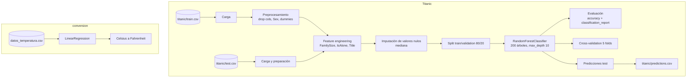

# machine-learning-101

Colección de proyectos introductorios de Machine Learning en Python. Actualmente incluye predicción de supervivencia del Titanic (Kaggle) con Random Forest y conversión Celsius a Fahrenheit con regresión lineal.

[](LICENSE)
[](https://python.org)
[](https://github.com/bi0punk/machine-learning-101/actions/workflows/ci.yml)

## Contenido

- [Características](#características)
- [Arquitectura](#arquitectura)
- [Stack](#stack)
- [Estructura del repositorio](#estructura-del-repositorio)
- [Instalación](#instalación)
- [Uso](#uso)
- [Configuración](#configuración)
- [Tests / CI](#tests--ci)
- [Datos](#datos)
- [Roadmap](#roadmap)
- [Licencia](#licencia)

## Características

- Predicción de supervivencia en Titanic con scikit-learn (Random Forest, clasificación binaria).
- Análisis exploratorio de datos (EDA) con pandas, seaborn y matplotlib.
- Feature engineering: `FamilySize`, `IsAlone`, `Title` extraído del nombre.
- Pipeline de preprocesamiento: limpieza de features, encoding, imputación mediana, train/validation split.
- Validación cruzada (5 folds) y reporte de clasificación.
- Generación de predicciones para el test set (CSV de submission).
- Conversión Celsius a Fahrenheit mediante regresión lineal (`conversion/`).
- Dataset de Titanic incluido (descargado de Kaggle).

## Arquitectura



## Stack

- **Python 3.11+**
- **pandas** — manipulación de datos
- **numpy** — cómputo numérico
- **scikit-learn** — modelos ML (regresión, clasificación)
- **seaborn / matplotlib** — visualización

## Estructura del repositorio

```
machine-learning-101/
├── .env.example
├── .github/workflows/ci.yml
├── .gitignore
├── LICENSE
├── README.md
├── pyproject.toml
├── requirements.txt
├── app.py                   # EDA + entrenamiento Random Forest Titanic
├── conversion/
│   └── app.py               # Regresión lineal Celsius ↔ Fahrenheit
├── titanic/
│   ├── train.csv            # Dataset de entrenamiento (Kaggle)
│   ├── test.csv             # Dataset de prueba
│   └── gender_submission.csv
├── scripts/
│   └── download_data.sh
└── tests/
    └── test_smoke.py
```

## Instalación

```bash
git clone https://github.com/bi0punk/machine-learning-101.git
cd machine-learning-101
python -m venv .venv && source .venv/bin/activate
pip install -r requirements.txt
```

## Uso

### Exploración y entrenamiento Titanic

```bash
python app.py
```

Corre el pipeline completo: EDA, feature engineering, imputación, entrenamiento de Random Forest, evaluación, cross-validation y genera `titanic/predictions.csv` para el test set.

### Conversión de temperatura

```bash
cd conversion
python app.py
# Precisión del modelo: ...
# 30 grados Celsius son 86.0 grados Fahrenheit.
```

> Nota: `conversion/app.py` espera un archivo `datos_temperatura.csv` (columnas `Celsius` / `Fahrenheit`) en el directorio actual.

## Configuración

No requiere variables de entorno. Ver `.env.example`:

```
# No environment variables required for this project.
# Add any custom configuration here.
```

## Tests / CI

```bash
pip install pytest ruff
pytest -q
```

CI — GitHub Actions (`.github/workflows/ci.yml`) sobre Python 3.11 con `uv`, en cada push y PR:

- `ruff check .`.
- `pytest -q`.

## Datos

El dataset de Titanic proviene de la [Kaggle Titanic Competition](https://www.kaggle.com/competitions/titanic). Archivos en `titanic/`:

| Archivo               | Descripción                       |
|-----------------------|-----------------------------------|
| `train.csv`           | Datos de entrenamiento (891 obs)  |
| `test.csv`            | Datos de prueba (418 obs)         |
| `gender_submission.csv` | Ejemplo de submission            |

Los CSVs están en `.gitignore` — descargar manualmente si se clona fresco (ver `scripts/download_data.sh`). La salida `titanic/predictions.csv` se genera al ejecutar `app.py`.

## Roadmap

- [x] Proyecto Titanic con entrenamiento y evaluación reales.
- [x] Conversión Celsius ↔ Fahrenheit con regresión lineal.
- [ ] Más datasets y pipelines completos.
- [ ] Deployment de modelos.

## Licencia

MIT — ver [LICENSE](LICENSE).